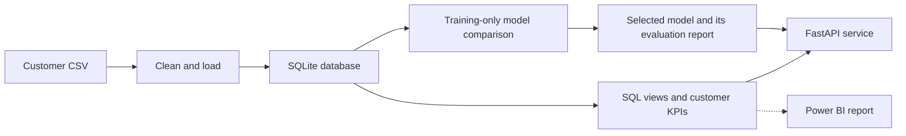

# Customer Churn: Model Integration and Evaluation

A team analytics pipeline connects customer data, churn predictions and BI reporting. As team lead and final integration contributor, I connected the trained model to FastAPI, aligned request and training schemas, and contributed the tests needed to make the components work together.

## The problem

The team needed to connect cleaned customer data, model predictions and dashboard measures so they could be checked together. I worked on this as a mentored capstone using a 7,043-record telecom snapshot, rather than a deployed retention service.

## What I built

As team lead, I coordinated technical review and final integration, connected the application programming interface (API) to the trained model, reconciled its request fields with the training schema, and added configurable artifact paths. Integration testing exposed an outcome-derived `churn_score` input; it was removed from training. I also wrote tests for data preparation, API behavior and prediction and contributed SQL-view checks alongside the team's data, modelling and reporting work.

The data preparation, initial training, API scaffold and Power BI report had other team owners. Mentor Adeyeri Michael contributed scaffolding and customer pagination. [CONTRIBUTORS.md](CONTRIBUTORS.md) records those boundaries. This personal portfolio copy also contains subsequent repairs to evaluation, reproducibility and packaging.

## Architecture



## How it works

The extract, transform and load (ETL) scripts clean the comma-separated values (CSV) file and load SQLite. Structured Query Language (SQL) views summarize churn by contract and tenure. The FastAPI service returns paginated customers, whole-dataset key performance indicators (KPIs), predictions and model metrics. The Power BI file uses imported data; I have not verified its refresh path in this run.

## ML / AI methodology

The target is whether a customer churned (`churn_value`). Inputs include contract, tenure, services and charges; engineered features group tenure, count subscribed services and estimate average monthly spend. Categorical values are encoded into indicator columns. Outcome-derived `churn_score`, `churn_reason` and `cltv`, identifiers and geographic fields are excluded from model inputs.

Five candidate families are compared: Logistic Regression, Decision Tree, Random Forest, XGBoost and LightGBM. The baseline predicts the training-set majority class and uses its class proportions for risk scores.

I reserve 20% of the rows for the final test and use the other 80% to compare models. The split keeps similar proportions of churned and retained customers in both parts—called a stratified split—and uses a fixed random seed of 42 so the same rows can be selected again. Five-fold cross-validation divides the training data into five parts: each candidate learns from four parts and is checked on the fifth, rotating through all five. Data preparation is fitted only on the learning part. A classifier that always predicts the majority class provides the baseline. After selecting the winner by its risk-ranking score, I refit it on the training portion and evaluate it on the untouched 1,409-row final test. I did not tune the models or the prediction threshold.

## Engineering

The FastAPI application validates requests with Pydantic, protects business endpoints with an `X-API-Key`, and keeps database access, services and routes separate. SQL aggregation covers the whole table rather than only the current customer page. Automated tests cover data preparation, prediction, API contracts and artifact consistency; Bash and PowerShell scripts check a running service.

Training now saves the selected model with its holdout metrics and the exact report checksum. `/model-metrics` checks that the report belongs to the loaded prediction model. It rejects a restored or edited report from another run. Tests and experiments that redirect their report also redirect their model, so they cannot silently replace the serving model.

Dependencies and the runtime are pinned. These checks establish local behavior; Docker and the optional Streamlit client were not verified in this release. No green GitHub Actions result is claimed while account billing blocks runs.

## Results

The integrated local API serves customer records, dataset KPIs, churn predictions and metrics tied to the loaded model. The request contract, prediction artifact and evaluation report can be inspected together through [API examples](docs/api_examples.md) and the [model comparison](evaluation/model_comparison.md).

The current recorded run used **Python 3.11.12 on Windows** and selected Logistic Regression:

| Holdout measure | Logistic Regression | Majority-class baseline |
|---|---:|---:|
| Accuracy: share classified correctly | 0.8020 | 0.7346 |
| Precision: share of predicted churners who churned | 0.6480 | 0.0000 |
| Recall: share of actual churners identified | 0.5561 | 0.0000 |
| ROC AUC: area under the receiver operating characteristic curve | 0.8494 | 0.5000 |

The confusion matrix is `[[922, 113], [166, 208]]`: the model correctly identified 208 churners and missed 166. Its ranking performance beats the baseline, but that does not establish reliable retention decisions.

[evaluation/model_comparison.md](evaluation/model_comparison.md) is the current result source. [The run record](docs/current_run.md) explains the environment and checks. Older Linux results and the earlier selected-on-test comparison are explicitly historical under `evaluation/reproduction/` and `evaluation/legacy/`; they are not current competing results. Native numerical libraries can produce different fits across systems, so I do not claim identical numbers on every machine.

The 13 October 2026 artifact-present suite passed **154 tests**, with no skips, and the PowerShell live API checks passed **29 checks**. Deliberately replacing the active report caused `/model-metrics` to reject it with HTTP 500; restoring the exact paired report returned HTTP 200.

## Demo


The pictured dataset totals were checked against the SQL views in the historical release verification. Its `Avg Churn Score` card is an outcome-derived source field, not an input to the trained model. The [Power BI file](dashboard/churn_dashboard.pbix) and other captures remain historical; the Model Predictions page does not represent the current evaluation. [API examples](docs/api_examples.md) show the current local contract.

There is no live hosted service. The local API is the current executable demo.

## Run locally

Supported runtime: **Python 3.11**; the current recorded run uses the patch version in `.python-version`. Install the pinned requirements in an isolated environment. From PowerShell 7 on Windows:

```powershell
git clone https://github.com/Tessa-Saumu/Customer-Churn-ML-Portfolio.git
cd Customer-Churn-ML-Portfolio
python -m venv .venv
.venv/Scripts/python.exe -m pip install -r requirements.txt
Copy-Item .env.example .env
# Edit .env: set API_KEY=local-dev-key
.venv/Scripts/python.exe database/init_db.py
.venv/Scripts/python.exe etl/load_to_db.py
.venv/Scripts/python.exe database/init_views.py
.venv/Scripts/python.exe training/evaluate_models.py
.venv/Scripts/python.exe scripts/generate_model_comparison_csv.py
.venv/Scripts/python.exe -m pytest -q
.venv/Scripts/python.exe -m uvicorn app.main:app --host 127.0.0.1 --port 8000
```

After the server is ready, open a second terminal at the repo root:

```powershell
$env:API_KEY='local-dev-key'
./scripts/verify_endpoints.ps1
```

The same Python pipeline commands work on Linux using the environment's Python executable. The Bash acceptance script also needs `curl` and `jq`: `API_KEY=local-dev-key ./scripts/verify_endpoints.sh`. Restart the API after training so predictions and metrics both use the newly saved run. The database and model are generated locally and are not committed.

## Repository structure

- `etl/`, `database/`, `sql/`: cleaning, SQLite loading and analysis views.
- `training/`, `predict.py`: features, model comparison and prediction.
- `app/`: API routes, schemas, services and data access.
- `evaluation/`: current report and explicitly historical results.
- `dashboard/`: team Power BI file and historical screenshots.
- `tests/`, `scripts/`, `docs/`: automated checks, live checks and run records.

## Limitations

This is a local project. There is no hosted deployment, production usage or measured business impact. The last recorded GitHub Actions verification was blocked by account limits; I do not claim a green CI (continuous integration) run. Docker and the optional Streamlit client remain unverified.

The static snapshot has no time index, so this evaluation says nothing about future periods or other carriers. Logistic Regression reaches its 1,000-iteration limit without converging. Recall remains limited, and no calibration or threshold study was performed. Inputs above 72 months still have an open tenure-bucket edge. The API uses a shared key and loads its model at startup; it is not a production security design.

The [dataset provenance](docs/data_provenance.md) records unresolved redistribution permission. Historical dashboard model visuals should not be used as the current evaluation source.

## What I would improve next

1. Investigate convergence, calibration and the decision threshold using training-side validation.
2. Cover tenure values above 72 months with a deliberate feature contract.
3. Refresh and verify the Power BI report against the current model/report pair.

## My contribution

I owned model/API integration, automated test suites, technical review and final integration. I corrected the outcome-derived score input exposed during integration. I did not own the initial data pipeline, initial model training or Power BI dashboard. [CONTRIBUTORS.md](CONTRIBUTORS.md) records team boundaries; later repairs in this personal copy were made with AI assistance and do not change the original ownership record.
